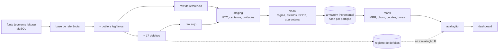

# Qualidade de dados num ETL de SaaS por assinatura

<p>
  
  
  
  
</p>

**Sem limpeza, o MRR de um streaming por assinatura sai 4,0% acima da verdade, a base ativa 3,6% e o engajamento
5,1%.** Com a combinação de técnicas recomendada aqui, os três ficam a menos de 0,2% da verdade. O erro que mais custa
não é deixar sujeira passar: é limpar demais. Tratar maratona de estreia como erro derruba as horas por assinante em 12%,
e em 31% no mês mais afetado.

**[Abrir o dashboard](https://arielabade.github.io/saas-data-quality/dashboard/)** ·
[resultados completos](reports/RESULTADOS.md) · [catálogo de defeitos](docs/CATALOG.md) · [decisões](docs/DECISIONS.md)

> **Decisão.** Regras de negócio corrigem; estatística sinaliza. Deduplicar a cobrança, reconstruir a assinatura como
> máquina de estados e aplicar limites físicos removem o erro sem tocar em cliente real. IQR, z-score e Isolation Forest
> entram só para marcar, e só tiram algo das métricas quando a anomalia vem com explicação (robô).

---

## 01 — Contexto

Um serviço de streaming por assinatura (Básico com anúncios, Padrão e Premium; mensal ou anual; cartão, Pix e boleto)
calcula MRR, churn e engajamento a partir de um ETL que junta cobrança, eventos de assinatura e logs de uso de TV,
celular e web.

### Dados

**SIMULADOS.** Nenhum dado real de empresa aparece aqui.

| | |
| --- | --- |
| Fonte | base sintética [`dados-sinteticos-streaming-cinelume`](https://github.com/arielabade/dados-sinteticos-streaming-cinelume), carregada num MySQL 8 |
| Escala | 6 mil contas, out/2023 a out/2026, 1,2 milhão de reproduções e 1 milhão de sessões |
| Escopo | 14 tabelas: contas, perfis, aparelhos, planos, preços, assinaturas, eventos, faturas, pagamentos, catálogo, sessões e reproduções |
| Perfil | [`docs/DATA_SOURCE.md`](docs/DATA_SOURCE.md) e [`reports/profile/PROFILE.md`](reports/profile/PROFILE.md) |

O perfil mostrou que a base "limpa" não é limpa:
- 21% das reproduções do app 6.x móvel vêm em milissegundos;
- 299 webhooks de pagamento já chegam duplicados;
- vários perfis tocam ao mesmo tempo no mesmo aparelho;
- a base já tem contas de QA e robôs.

Isso virou regra, e a avaliação separa esses achados nativos dos defeitos injetados.

---

## 02 — Problema

Defeito de dados num SaaS não aparece como erro: aparece como um número plausível e errado. O webhook duplicado vira
receita. O cancelamento com data trocada vira um cliente que nunca sai. A maratona de estreia parece outlier.

Em dado real não dá para medir nada disso, porque não se sabe o que era defeito. Também não se sabe quanto cada técnica
de limpeza acerta, quanto cliente legítimo ela derruba ou quanto cada atalho custa em MRR e churn.

---

## 03 — Estratégia

| Decisão | Por quê |
| --- | --- |
| **Injetor de defeitos com registro** (`src/dq/corrupt`) | 17 tipos de defeito de streaming, com semente fixa; cada alteração vai para um registro (tabela, chave, coluna, tipo, original, sujo). Isso é o gabarito. |
| **Outliers verdadeiros também injetados, marcados como legítimos** | Maratona de estreia, usuários intensos, pico de feriado e compartilhamento pago medem quanto a limpeza destrói. |
| **O ETL nunca lê o registro** | Uma barreira por AST e outra em tempo de execução fazem um teste falhar se ler. |
| **Verdade = base sem defeitos pelo mesmo pipeline** | Isola o efeito dos defeitos das imperfeições nativas. |
| **Uma ablação por regra** | O pipeline completo com uma regra desligada mostra o custo de não aplicá-la. |
| **Regras de domínio antes de estatística** | Chave idempotente, máquina de estados, SCD2 de preços, hora do servidor e limites físicos. |



Detalhes: [arquitetura](docs/ARCHITECTURE.md), [técnicas com fórmulas](docs/TECHNIQUES.md),
[definições de MRR, base ativa e churn](docs/METRICS.md).

---

## 04 — Resultado

### Quanto da base estava suja

5,9% das linhas tinham ao menos um defeito: 23% das contas (sobretudo UF nula em cadastro pela TV), 8,1% das reproduções
e 4,8% dos pagamentos.

### Precisão e recall por técnica

Precisão = acertos / (acertos + falsos positivos + legítimos derrubados). O que a técnica também marca na base de
referência é achado nativo e fica fora da conta.

| Técnica | Unidade | Precisão | Recall | Legítimos derrubados |
| --- | --- | ---: | ---: | ---: |
| Regras de cadastro (contas internas e de teste) | conta | 100,0% | 97,5% | 0 |
| Integridade referencial (quarentena de órfãos) | linha | 100,0% | 100,0% | 0 |
| Chave idempotente + janela (pagamentos) | linha | 99,2% | 100,0% | 0 |
| SCD2: preço vigente na data | fatura | 99,7% | 100,0% | 0 |
| Máquina de estados (ordem dos eventos) | evento | 98,7% | 100,0% | 0 |
| Intervalos por conta (assinatura sobreposta) | assinatura | 100,0% | 100,0% | 0 |
| Chave natural (replay de lote) | linha | 100,0% | 100,0% | 0 |
| Contrato de formato (fuso misturado) | linha | 100,0% | 100,0% | 0 |
| Desvio por aparelho (relógio errado) | linha | 100,0% | 100,0% | 0 |
| Sequência sem sobreposição (troca de ID de aparelho) | aparelho | 99,6% | 89,9% | 0 |
| Regra física (por reprodução) | linha | 96,6% | 100,0% | 182 |
| **IQR por mês** | perfil-dia | 88,3% | 54,7% | **590** |
| **Z-score robusto (mediana/MAD)** | perfil-dia | 84,7% | 63,1% | **908** |
| Regra física (perfil-dia) | perfil-dia | 88,7% | 71,2% | 53 |
| Z-score no total diário (sem sazonalidade) | dia | 100,0% | 33,3% | 0 |
| Sazonal (tendência + dia da semana) | dia | 33,3% | 100,0% | 4 |
| **Sazonal + calendário de estreias e feriados** | dia | 60,0% | 100,0% | **0** |
| Isolation Forest (qualquer anomalia) | conta | 68,2% | 100,0% | 4 |
| **Isolation Forest + explicação (robô / telas)** | conta | 75,0% | 100,0% | 2 |

As regras de domínio passam de 95% de precisão e recall. Os detectores estatísticos pegam metade a dois terços dos
defeitos de uso e derrubam centenas de perfil-dias legítimos. A sazonalidade com calendário pega os 3 dias de replay de
lote sem derrubar nenhuma estreia nem feriado. O z-score simples pega 1 de 3. A região imputada para UF nula acerta
99,8%, porque o nulo é MAR (depende do aparelho de cadastro) e a região vem das sessões da própria conta.

### Impacto no negócio (erro médio contra a verdade, jan/2024 a out/2026)

| | MRR | Assinantes ativos | Churn mensal | Horas por assinante |
| --- | ---: | ---: | ---: | ---: |
| Sem limpeza | **+4,04%** | **+3,63%** | −0,14 p.p. (−2,7% do churn) | **+5,08%** |
| Com limpeza | +0,01% | +0,01% | 0,00 p.p. | +0,15% |

Em out/2026, sem limpeza, o MRR sai R$ 7,7 mil por mês acima da verdade (R$ 73,7 mil somados em 12 meses), e a base
ativa tem 184 contas a mais. A retenção de 12 meses por coorte sai 1,8 p.p. otimista (57,2% contra 55,4%).

### Decisões erradas e o que custam

| Decisão | Efeito |
| --- | --- |
| Remover outliers de IQR como se fossem erro | horas por assinante **−12,0%** (−31% em out/2026) |
| Não aplicar limites físicos | horas por assinante +7,6% (+15% em out/2026) |
| Não deduplicar o webhook de pagamento | **MRR +3,0%** (+4,5% em jan/2026) |
| Descartar eventos atrasados (janela 0) | horas −2,8%; só 13,5% dos atrasados entram no mês certo |
| Usar os eventos de assinatura como vieram | base ativa +2,4%, churn −0,15 p.p. (o cancelamento antes da criação faz a conta "nunca churnar") |
| Não filtrar contas internas e de teste | base ativa +0,9% |
| Não resolver assinaturas sobrepostas | MRR +0,4% (+1,3% em ago/2026) |
| Não deduplicar replay de lote | horas +3,4% no mês do replay |

### Modelo de churn

Com as mesmas contas e o mesmo rótulo, sem limpeza as features ficam enviesadas: horas assistidas em 30 dias +8%,
falhas de pagamento em 90 dias +5% (retentativas duplicadas) e dias sem uso +2%. O **ranking** do modelo resiste
(AUC 0,716 nas três versões), porque o viés é quase uniforme entre as contas. O risco está em regra de negócio com limiar
fixo: "duas falhas de pagamento" ou "menos de 10 horas no mês" muda de quem dispara.

### Carga incremental

Rodar o ETL duas vezes gera arquivos byte a byte idênticos e recalcula zero meses. Uma semana nova de lotes regrava 2
partições e recalcula 2 meses de engajamento, incluindo o mês anterior, que recebeu atrasados do celular offline.

> **Recomendação.**
> 1. Deduplicar a cobrança por chave idempotente com janela de 1 h antes de qualquer soma.
> 2. Reconstruir a assinatura como máquina de estados e resolver sobreposição por conta.
> 3. Tirar internas, testes e robôs das métricas, sem apagá-los.
> 4. Aplicar limites físicos e corrigir fuso e relógio pela hora do servidor.
> 5. Usar estatística só para sinalizar.
> 6. Carregar incrementalmente, com janela de 30 dias para atrasados.
>
> Errar para mais em MRR é reportar receita que não existe. Errar para menos em engajamento é concluir que a estreia
> não funcionou.

---

## 05 — Limites e próximo passo

- **Dados simulados.** O que se transfere é o método e a ordem de grandeza dos efeitos, não os números. Defeitos
  reais são mais correlacionados entre si (o mesmo deploy quebra fuso e unidade ao mesmo tempo).
- **As taxas de defeito foram escolhidas por mim.** Com 30% de webhook duplicado em vez de 3%, o MRR sobe dez vezes
  mais. A tabela de ablações mostra o efeito por ponto de defeito, não uma estimativa do mundo real.
- **O injetor e o ETL foram escritos pela mesma pessoa.** As regras de domínio tendem a acertar defeitos que o autor
  sabe injetar. As técnicas estatísticas, que não sabem nada do injetor, são a medida mais honesta.
- **Isolation Forest ainda marca muito achado nativo** (contas com várias pessoas na mesma TV). Separar "estranho" de
  "acionável" depende da explicação, que aqui é uma regra manual.
- **Próximo passo:** rodar o mesmo protocolo com defeitos correlacionados (um deploy ruim, em vez de defeitos
  independentes) e medir quanto a ordem das regras passa a importar.

---

## Como rodar

```bash
git clone https://github.com/arielabade/saas-data-quality
cd saas-data-quality
python -m venv .venv && source .venv/bin/activate
pip install -e ".[dev]"
export DQ_SOURCE_DIR=/caminho/para/dados-sinteticos-streaming-cinelume   # somente leitura

make data       # gera a base (fora da fonte), sobe o MySQL, carrega, extrai e perfila
make corrupt    # injeta defeitos e grava o registro
make etl        # raw -> staging -> clean -> marts (incremental, idempotente)
make evaluate   # 15 variantes do ETL, precisão/recall, impacto no negócio, modelo de churn
make report     # RESULTADOS.md, QUALIDADE.md e o dashboard
make test       # 125 testes (inclui ponta a ponta com perfil pequeno)

make e2e        # tudo no perfil pequeno, sem MySQL (é o que o CI roda)
```

- **Credenciais:** `make env` cria um `.env` local, fora do git, com uma senha aleatória para o MySQL. Nenhuma
  credencial fica no código.
- **Recursos:** a escala usada pede cerca de 3 GB de RAM por execução do ETL. A avaliação usa `DQ_WORKERS` processos
  (padrão 2).

## Mapa do repositório

```
src/dq/extract/     gera a base fora da fonte, lê o MySQL, amostra contas no perfil ci
src/dq/profile/     perfil de cada tabela, integridade, sequências e imperfeições nativas
src/dq/corrupt/     injetor de defeitos, outliers legítimos e registro
src/dq/clean/       staging e um módulo por problema (dedup, tempo, aparelhos, limites, nulos, outliers, escalas)
src/dq/state/       máquina de estados da assinatura, SCD2 de preços, churn
src/dq/load/        quarentena, carga incremental idempotente, marts
src/dq/contracts/   contratos pandera por camada
src/dq/evaluate/    variantes, precisão/recall, impacto no negócio, modelo de churn
src/dq/report/      RESULTADOS.md e dashboard
config/             settings.yaml, corruption.yaml, cleaning.yaml
docs/               fonte, arquitetura, catálogo, técnicas, métricas, decisões e o dashboard (GitHub Pages)
reports/            perfil, resultados e relatório de qualidade da execução limpa
tests/              regras, máquina de estados, incremental, barreira do registro, ponta a ponta
```
