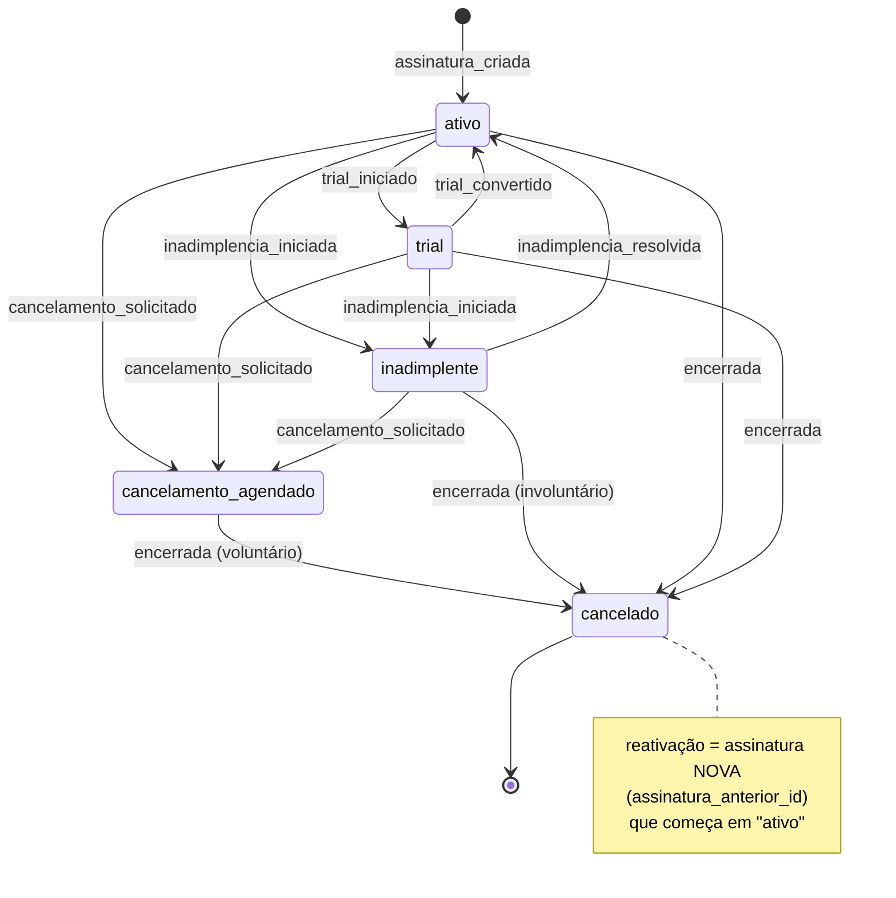
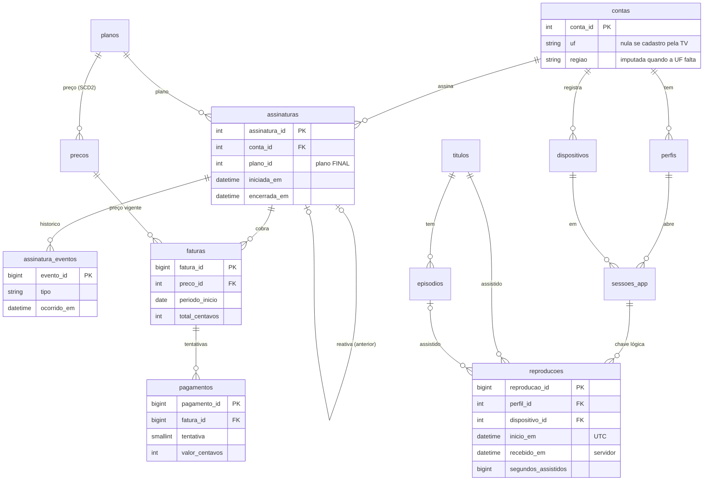

# Arquitetura

## Camadas

```mermaid
flowchart LR
    subgraph fonte["Fonte (somente leitura)"]
        G["gerar_dados.py<br/>schema.sql"]
    end
    subgraph extract["dq.extract"]
        MY[("MySQL 8.4<br/>docker compose")]
        SRC["data/source<br/>base de referência"]
    end
    subgraph corrupt["dq.corrupt"]
        LEG["outliers legítimos<br/>e anomalias reais"]
        RAWR["data/raw_reference"]
        DEF["17 tipos de defeito"]
        RAW["data/raw"]
        LOG[("data/defect_log")]
    end
    subgraph etl["ETL (dq.clean, dq.state, dq.load, dq.contracts)"]
        STG["staging<br/>tipos, UTC, centavos,<br/>textos canônicos"]
        CLN["clean<br/>regras + máquina de estados<br/>+ SCD2 + quarentena"]
        WH[("armazém incremental<br/>partição por mês<br/>hash por partição")]
        MRT["marts<br/>MRR, assinantes, churn,<br/>coortes, engajamento"]
    end
    subgraph evaluate["dq.evaluate + dq.report"]
        EV["precisão/recall<br/>impacto no negócio<br/>modelo de churn"]
        DASH["docs/dashboard"]
    end
    G --> MY --> SRC --> LEG --> RAWR
    LEG --> DEF --> RAW
    DEF -.-> LOG
    LEG -.-> LOG
    RAW --> STG --> CLN --> WH --> MRT
    RAWR --> STG
    MRT --> EV
    LOG -.->|só o evaluate lê| EV
    EV --> DASH
```

O registro de defeitos só é escrito por `dq.corrupt` e só é lido por `dq.evaluate`. Nenhum módulo do ETL o importa ou cita.
Duas barreiras garantem isso: uma por AST, sobre o código-fonte, e outra em tempo de execução, rodando o ETL com qualquer
leitura do registro convertida em erro (`tests/test_defect_log_guard.py`).

## Ordem das regras no ETL

A ordem importa: cada regra precisa da anterior.

1. **Staging.** Converte cada formato de timestamp para UTC, cada um em seu grupo, normaliza os textos, passa o dinheiro
   para centavos e converte os milissegundos do app 6.x móvel.
2. **Cadastro.** Contas internas e de teste, mecanismo dos nulos e imputação da região.
3. **Integridade.** Órfãos vão para a quarentena.
4. **Cobrança.** Deduplicação de pagamentos e, em seguida, o preço de cada fatura conferido contra o SCD2. A
   deduplicação vem antes porque o SCD corrige o valor dos pagamentos que sobram.
5. **Estado.** Ordem dos eventos, depois linha do tempo, sobreposição de assinaturas e períodos por conta (churn).
6. **Uso.**
   - fuso (por formato);
   - relógio (por aparelho, com a hora do servidor);
   - unificação de aparelhos;
   - deduplicação de uso;
   - limites físicos.

   Fuso e relógio vêm antes da deduplicação para que réplicas com o mesmo erro colidam na chave; a unificação vem antes
   dos limites para que "24 h por aparelho" valha para o aparelho físico.
7. **Detectores (só sinalizam).** IQR, z-score robusto, sazonal e Isolation Forest. Robôs saem das métricas.
8. **Contratos do clean** (bloqueantes), **carga incremental** e **marts**.

## Máquina de estados da assinatura

- `upgrade`, `downgrade`, `metodo_pagamento_alterado` e `membro_extra_*` mantêm o estado e, quando for o caso, trocam o
  plano do intervalo.
- Qualquer par (estado, evento) fora da tabela `TRANSITIONS` é **transição inválida**: o evento é ignorado e sinalizado.
  Isso inclui qualquer evento depois de `encerrada`.
- **Correção de ordem:**
  - evento até 24 h antes da criação: desvio de relógio, corrigido para o instante da criação;
  - cancelamento ou encerramento mais de 24 h antes da criação: corrigido pela data do cabeçalho;
  - sem cabeçalho: vai para a quarentena.
- As 78 combinações estado × evento estão em `tests/test_state_machine.py`.

## Modelo de dados

Tabelas derivadas na camada clean:
- `linha_do_tempo`: intervalos de estado e plano por assinatura;
- `periodos_conta`: períodos vigentes por conta, com o tipo de churn;
- `dim_preco`: o SCD2 de preços;
- `contas_excluidas`: internas, de teste e robôs;
- `isolation_forest` e `dias_anomalos`: as marcações dos detectores.

## Carga incremental

- **Lote.** Cada linha de uso pertence ao lote do seu `recebido_em` (lotes de 7 dias).
- **Atraso.** Evento mais antigo que o início do lote menos 30 dias vai para a quarentena (`atrasado_fora_da_janela`).
  Dentro da janela, entra na partição do **mês do evento**.
- **Idempotência.** Cada partição guarda um hash do conteúdo em `warehouse/_estado.json`. Uma partição só é regravada
  se o hash mudou.
- **Recálculo.** Cada mês do mart de engajamento guarda o hash da sua entrada: partição, contas excluídas e base ativa no
  fim do mês. Só os meses cuja entrada mudou são recalculados.
- **Resultado.** Rodar o ETL duas vezes gera arquivos byte a byte idênticos e recalcula zero meses. Uma semana nova de
  lotes recalcula só os meses que ela tocou, incluindo os meses antigos que receberam atrasados.

Os marts de assinatura (MRR, churn, coortes) são recalculados inteiros a cada execução: são tabelas pequenas, vindas de uma
foto completa do sistema de cobrança ([DECISIONS.md](DECISIONS.md)).

## Responsabilidade de cada módulo

| Módulo | Papel |
|---|---|
| `dq.config` | Lê o YAML e as variáveis de ambiente (e o `.env`); nenhuma credencial no código. |
| `dq.domain` | Conhecimento de domínio puro: tipos de aparelho, UF → região/fuso, duração de conteúdo, CPF. |
| `dq.extract.generate` | Roda o gerador da fonte com saída e gabarito fora dela. |
| `dq.extract.extract` | Lê o MySQL (ou o Parquet, no CI) e grava `data/source`; amostra contas no perfil `ci`. |
| `dq.profile.profiler` | Perfil de cada tabela, integridade, sequências de eventos e imperfeições nativas. |
| `dq.corrupt.base` | Contexto, ids novos, geração de uso coerente e formato raw (timestamp por plataforma, `recebido_em`). |
| `dq.corrupt.legit` | Outliers verdadeiros e anomalias reais, que vão para a referência e para a base suja. |
| `dq.corrupt.defects` | Os 17 tipos de defeito, só na base suja. |
| `dq.corrupt.log` / `injector` | Registro de defeitos e orquestração. |
| `dq.clean.standardize` | Camada staging. |
| `dq.clean.test_accounts` | Contas internas, de QA e de teste. |
| `dq.clean.dedup` | Webhook e retentativa duplicados; replay de lote. |
| `dq.clean.timestamps` | Fuso misturado, relógio errado e chegada atrasada. |
| `dq.clean.devices` | Troca de ID do mesmo aparelho. |
| `dq.clean.usage_limits` | Limites físicos do tempo assistido e das sessões. |
| `dq.clean.nulls` | Mecanismo dos nulos e imputação da região. |
| `dq.clean.outliers` | IQR, z-score robusto, regra física, sazonal e Isolation Forest. |
| `dq.clean.scaling` | Min-max, z-score, robusta, log e Yeo-Johnson. |
| `dq.state.scd` | SCD2 de preços e conferência das faturas. |
| `dq.state.machine` | Máquina de estados, correção de ordem e sobreposição. |
| `dq.state.churn` | Períodos vigentes por conta e eventos de churn. |
| `dq.load.quarantine` | Integridade referencial com quarentena. |
| `dq.load.incremental` | Lotes, janela de atrasados, hash por partição. |
| `dq.load.marts` | MRR, assinantes e churn, coortes, engajamento. |
| `dq.contracts.schemas` | Contratos pandera por camada; o clean e os marts bloqueiam a execução. |
| `dq.pipeline` | Orquestra o ETL; cada regra pode ser desligada. |
| `dq.evaluate.*` | Variantes, precisão e recall, impacto no negócio, modelo de churn. |
| `dq.report.*` | `RESULTADOS.md`, `QUALIDADE.md` e o dashboard. |
